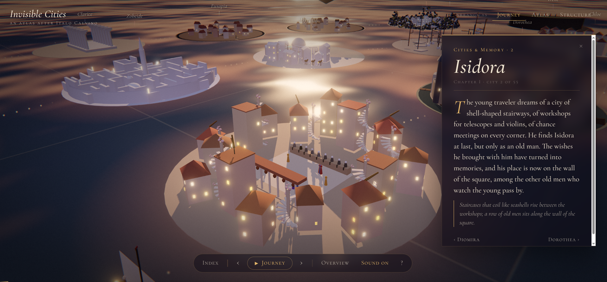
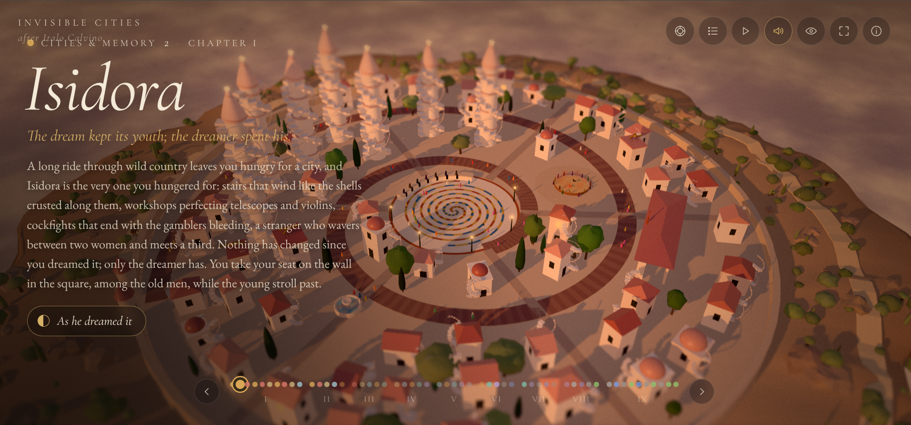

# Invisible Cities, one shot (October 2026)

[Piotr Migdał is right in his post.](https://quesma.com/blog/invisible-cities-one-shot/) As a [data vis specialist](https://p.migdal.pl/), Piotr asks himself the question: _What is my place in creating interactive media?_ And, after following his **call to action** (see post), I have one simple answer: yes.

My results of Piotr's experiment are here. I wrote about them, and about why this feels like an identity crisis for programmers, in my post [Opus 5.5 causing an identity crisis is real](https://www.kondz.io/blog/opus-5-5-causing-identity-crisis-is-real/).

## Open the interactive versions

Both results run in the browser, served from this repository on GitHub Pages:

- [Run 1: medium effort, no Ultracode](https://ktalik.github.io/invisible-cities-2026.10/cc-2.1.296-opus-5.5-medium-no-ultracode/) (55 islands on a dusk lagoon)
- [Run 2: max effort, Ultracode on](https://ktalik.github.io/invisible-cities-2026.10/cc-2.1.296-opus-5.5-max-with-ultracode/) (55 dioramas on the Khan's atlas). Only keyboard controls are available: `Left`/`Right` previous/next city, `Esc` back to the atlas, `H` hide text, `M` sound, `F` fullscreen.

They are the production builds exactly as the agents left them, with nothing fixed or rebuilt afterwards. They need a browser with WebGL.

## The experiment

Same prompt as in Piotr's post, given once, with no follow-up guidance:

> Make a three.js (pnpm) visualization of all Invisible Cities by Italo Calvino. Don’t ask questions, it is a one-shot task. You have 6h of work, use it until it becomes a masterpiece.

I ran it twice in Claude Code v2.1.296 with Opus 5.5, changing only the effort level and whether Ultracode (multi-agent workflows) was on:

| Run | Effort | Ultracode | Wall time | Result |
| --- | --- | --- | --- | --- |
| [`cc-2.1.296-opus-5.5-medium-no-ultracode`](cc-2.1.296-opus-5.5-medium-no-ultracode/run-1/) | medium | off | about 1 h, in a single turn | 55 islands on a dusk lagoon |
| [`cc-2.1.296-opus-5.5-max-with-ultracode`](cc-2.1.296-opus-5.5-max-with-ultracode/run-1/) | max | on | about 2 h of work over two sessions | 55 dioramas on the Khan's atlas |

Each run folder contains:

- `transcript.txt`: the full Claude Code session, as shown in the terminal,
- `screenshot.png`: one frame of the result (the city of Isidora in both runs, for comparison),
- `agent-output/`: the project exactly as the agent left it, including its own `README.md` and a production build in `dist/`.

## Run 1: medium effort, no Ultracode



One agent, one turn, about an hour. All 55 cities float as small procedural islands on a lagoon at eternal dusk, with Marco Polo's boat sailing the dotted route between them and the Khan's garden in the middle.

- Each city is modeled from its own passage: Octavia hangs in a net between two cliffs, Valdrada stands over its upside-down twin, Armilla is nothing but plumbing, Olinda grows ring by ring from a pinpoint.
- The cities glide between three arrangements: **Journey** (reading order, a spiral), **Atlas** (11 themes by 5 cities) and **Structure** (the theme by number grid turned 45 degrees, so each row is one chapter, which is the hidden structure of the book).
- A guided journey goes through all nine chapters with interludes in the Khan's garden and an epilogue.
- Generative sound, deep links (`/#octavia`), keyboard controls, a mobile layout.

Notable moment: the agent noticed that its first draft of the city descriptions came too close to the published translation and rewrote all of them as original paraphrases on its own.

## Run 2: max effort, Ultracode on



The orchestrating agent first fanned out research agents to write a visual design brief for each city, then fanned out builder agents, one per city or per series. The result is more ambitious:

- Every city is a self-contained, lazy-loaded diorama made from code alone (no models, no image textures), with its own sky, light and weather.
- Most cities have a transformation that acts out the city's idea: Valdrada's mirror, Zemrude seen from above or below, Moriana flipping to its rusted back, Ersilia's strings without houses.
- The cities are gathered on the Khan's atlas, a lacquered rose window: 11 sectors for the thematic series, 5 rings for their appearances, and a golden thread following the order in which Marco tells them. The chessboard in the centre leads to Venice, "the city never named".
- A journey through all 55 cities with chapter interludes, ending in an epilogue where the cities sink to embers and only the Hidden Cities stay lit.

It did not go smoothly. About 45 agents running at once hit my account's rate limit and most city work in progress was lost. After I typed `continue`, the agent resumed with 11 agents (one per series) and wrote the missing texts itself, at the cost of the planned critique and refinement pass. It openly lists its weakest results in the transcript (Argia reads as a dark box, Leandra is overly bright, Venice never got its refinement).

## Running the results locally

Both projects are plain Vite + three.js apps:

```bash
cd cc-2.1.296-opus-5.5-medium-no-ultracode/run-1/agent-output   # or the max run
pnpm install
pnpm dev        # http://localhost:5173
```

The texts in both apps are original paraphrases written by the agents, not quotations from the book. _Invisible Cities_ (_Le città invisibili_, 1972) is by Italo Calvino. Read the book.
